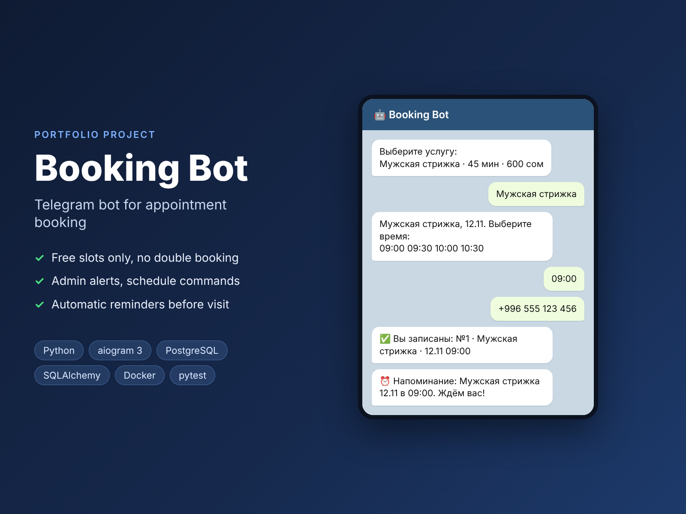

# Booking Bot: appointment booking in Telegram



A Telegram bot for small service businesses (barbershops, salons, clinics, tutors). Clients book an appointment in a few taps. The owner gets notified and can see the schedule, and clients get a reminder before their visit.

> Portfolio project. The business logic is covered by tests, and the full flow was checked with a simulated Telegram API.

**Stack:** Python 3.12 · aiogram 3 · SQLAlchemy 2 (async) · PostgreSQL / SQLite · pydantic-settings · pytest · Docker Compose · GitHub Actions

## Features

**For clients**
- Choose a service, then a day, then a free time slot, then send a phone number (Telegram contact button or typed)
- Only real free slots are shown: past times, already booked times and slots that would run past closing time are hidden
- Double booking is prevented: the slot is re-checked right before saving
- "My bookings" lists upcoming bookings and lets the client cancel one
- An automatic reminder is sent N hours before the visit

**For the owner (admin)**
- Instant notification about every new booking and cancellation
- `/today`, `/tomorrow` show the schedule with client names and phones
- `/cancel_booking <id>` cancels any booking
- Working hours, slot step, booking horizon, reminder time and timezone are set in `.env`

## Architecture

```
bot/
├── main.py          # startup, dependency wiring, reminder loop
├── config.py        # settings from environment (.env)
├── db.py            # SQLAlchemy models: Service, Booking
├── services.py      # business logic (slots, booking, cancel, reminders), no Telegram code
├── keyboards.py     # inline / reply keyboards, typed callback data
└── handlers/
    ├── user.py      # client flow (FSM)
    └── admin.py     # admin commands, protected by an IsAdmin filter
tests/               # pytest tests for the business logic (in-memory SQLite)
```

The business logic in `services.py` has no Telegram code, so it is tested directly and can be reused (for example, in a web admin panel). All times are stored in UTC and shown in the configured timezone.

## Run locally

```bash
python -m venv .venv && source .venv/bin/activate
pip install -r requirements-dev.txt
cp .env.example .env        # put your BOT_TOKEN and ADMIN_IDS here
python -m bot.main
```

## Run with Docker (PostgreSQL)

```bash
cp .env.example .env        # put your BOT_TOKEN and ADMIN_IDS here
docker compose up -d --build
```

## Tests

```bash
pytest -q
ruff check .
```

The tests cover free-slot calculation, hiding past slots, double-booking protection, cancellation rules (owner check, repeated cancel), the schedule for a day and reminder selection.

## Possible extensions

- Several masters/staff with separate schedules
- Online prepayment (Telegram Payments)
- Web admin panel and Google Sheets export
- Alembic migrations
